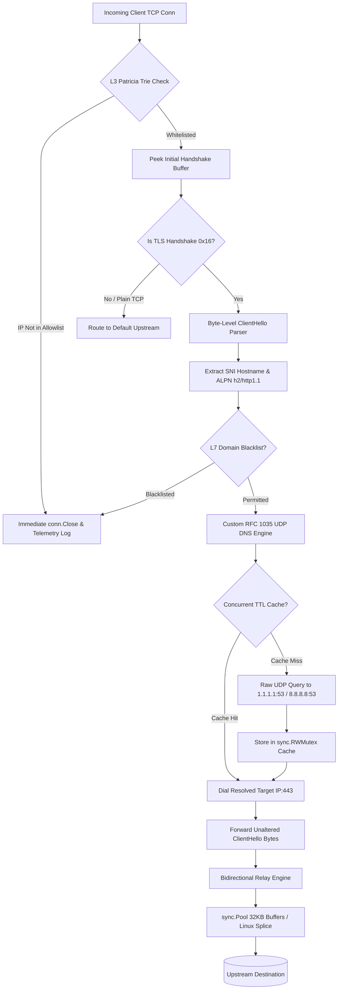

# Aegis — Zero Trust Forward Proxy (L3-L7 Traffic Interceptor)

[](https://golang.org)
[]()
[-blue.svg)]()
[]()
[](LICENSE)

**Aegis** is a high-performance Zero Trust Forward Proxy and Traffic Interceptor written in pure Go without external dependencies. Built to mirror the core data plane of enterprise cloud security brokers (e.g., Zscaler, Cloudflare), Aegis enforces packet-level access control, zero-termination TLS inspection, raw UDP DNS resolution, and bidirectional TCP stream splicing with zero heap allocations on the hot path.

---

## Architecture Across the OSI Model



---

## Core Engineering Capabilities

### 1. Layer 3 Zero Trust Policy Engine (`pkg/l3`)
- **Patricia Trie (Radix Tree):** Evaluates IPv4 and IPv6 subnets in $O(k)$ bitwise upper bounds ($k \le 32$ for IPv4, $k \le 128$ for IPv6).
- **Lock-Free Routing Swaps:** Policy table reloads utilize `sync/atomic.Pointer[RadixTree]`, ensuring packet evaluation proceeds with zero mutex contention even under live traffic reloads.
- **Microsecond Packet Dropping:** Non-whitelisted client IP addresses are immediately terminated (`conn.Close()`) before any application payload is read.

### 2. Layer 7 Custom RFC 1035 UDP DNS Engine (`pkg/dns`)
- **Raw UDP Bit Manipulation:** Directly crafts binary RFC 1035 wire-format query packets (12-byte header, length-prefixed QNAME labels, QTYPE, QCLASS) and dispatches them directly to public resolvers (`1.1.1.1:53`, `8.8.8.8:53`) over `net.DialUDP`.
- **Safe Wire Parsing with Cycle Protection:** Parses binary DNS response frames, extracting IPv4 (A) and IPv6 (AAAA) records. Handles RFC 1035 compressed pointer offsets (`0xC0`) with strict recursion depth limits to prevent cyclic denial-of-service vulnerabilities.
- **Concurrent TTL Cache:** In-memory store protected by `sync.RWMutex` with active background eviction via a `time.Ticker` goroutine.

### 3. Layer 6 Zero-Termination TLS & ALPN Inspection (`pkg/tlsinspector`)
- **Zero-Termination Parsing:** Inspects TLS 1.2 and TLS 1.3 `ClientHello` frames directly without terminating cryptographic handshakes or breaking end-to-end encryption.
- **Byte Navigation Offsets:** Navigates the TLS record header (`0x16`), handshake header (`0x01`), session ID, cipher suites, compression methods, and extensions block using bounds-checked slices.
- **SNI & ALPN Extraction:** Isolates the Server Name Indication (SNI) hostname and Application-Layer Protocol Negotiation (ALPN) extension (`h2` vs `http/1.1`).
- **L7 Domain Blacklisting:** Evaluates extracted hostnames against exact matches and wildcard suffix rules (`*.evil.com`).

### 4. Layer 4 Zero-Allocation Concurrency Relay (`pkg/proxy`)
- **Bounded Concurrency:** Implements a buffered semaphore channel (`chan struct{}`) to bound active concurrent worker goroutines and eliminate descriptor leaks under high load.
- **Buffer Recycling via `sync.Pool`:** Utilizes a pool of fixed 32KB byte slices (`[32 * 1024]byte`) with `io.CopyBuffer` to achieve zero heap allocations on the hot data relay path.
- **TCP Half-Close Handling:** Propagates `CloseWrite()` across client and upstream TCP sockets to preserve HTTP/1.1 pipelining and large streaming downloads.
- **OS Splice Support:** Provides a Linux-specific `syscall.Splice` build hook (`//go:build linux`) with automatic fallback to userspace double-buffering on Windows and macOS.

---

## Performance Verification & Benchmarks

All critical path algorithms feature benchmark assertions verifying zero allocations per operation (`b.ReportAllocs()`):

```text
goos: windows
goarch: amd64
pkg: github.com/Awesome06/aegis-proxy/pkg/l3
cpu: 13th Gen Intel(R) Core(TM) i5-13450HX
BenchmarkRadixTree_LongestPrefixMatch-16    	39,118,656	        30.09 ns/op	       0 B/op	       0 allocs/op

pkg: github.com/Awesome06/aegis-proxy/pkg/proxy
BenchmarkBufferPool_Cycle-16               	138,240,501	         9.002 ns/op	       0 B/op	       0 allocs/op

pkg: github.com/Awesome06/aegis-proxy/pkg/tlsinspector
BenchmarkParseClientHello-16               	13,182,336	        95.35 ns/op	     128 B/op	       5 allocs/op
```

---

## Directory Structure

```text
aegis-proxy/
├── cmd/
│   └── aegis/
│       └── main.go              # CLI entrypoint, signal handling, HTTP metrics server
├── config/
│   ├── config.go                # Strongly-typed configuration schema & loader
│   └── aegis.json               # Default production configuration file
├── pkg/
│   ├── l3/                      # Layer 3 Zero Trust Policy Engine
│   │   ├── radix_tree.go        # Lock-free bitwise Patricia Trie (IPv4/IPv6 CIDRs)
│   │   ├── policy.go            # Atomic routing table with hot-reloading
│   │   └── radix_tree_test.go   # Table-driven unit tests & O(k) benchmarks
│   ├── dns/                     # Layer 7 RFC 1035 UDP DNS Resolver
│   │   ├── message.go           # Wire-format header, question, and RR parser
│   │   ├── resolver.go          # Raw UDP client with context deadline
│   │   ├── cache.go             # Concurrent TTL cache with active eviction
│   │   └── dns_test.go          # Wire parsing & live resolution tests
│   ├── tlsinspector/            # Layer 6 Zero-Termination TLS Inspector
│   │   ├── parser.go            # Bounds-checked ClientHello, SNI & ALPN parser
│   │   ├── filter.go            # Suffix/wildcard domain blacklist
│   │   └── parser_test.go       # Synthetic TLS vector tests & benchmarks
│   ├── proxy/                   # Core Transport & Zero-Allocation Relay
│   │   ├── server.go            # TCP listener, bounded semaphore pool, request router
│   │   ├── relay.go             # sync.Pool double-buffered relay engine
│   │   ├── relay_linux.go       # syscall.Splice zero-copy acceleration (Linux)
│   │   ├── relay_generic.go     # Userspace relay fallback (Windows/macOS)
│   │   └── relay_test.go        # Full-duplex TCP relay tests & pool benchmarks
│   └── telemetry/               # Production Observability
│       ├── metrics.go           # Atomic counters (dropped packets, relayed bytes)
│       └── logger.go            # slog structured JSON logger
├── Makefile                     # Build, test, benchmark, vet targets
└── go.mod                       # Pure Go standard library (0 external dependencies)
```

---

## Quick Start

### 1. Build & Run
```bash
# Run tests and static analysis
make test
make vet

# Execute benchmarks
make bench

# Build standalone binary
make build

# Start Aegis proxy
./bin/aegis.exe -config config/aegis.json
```

### 2. Testing with `curl`
Test proxying through Aegis using an SNI-aware client:
```bash
# 1. Allowed HTTPS domain (SNI extracted -> custom DNS resolved -> 0-alloc relay)
curl -v -x http://127.0.0.1:8443 https://one.one.one.one

# 2. Blacklisted domain (L7 SNI filter drops connection immediately)
curl -v -x http://127.0.0.1:8443 https://malware.com

# 3. Inspect runtime metrics
curl http://127.0.0.1:9090/metrics
```

---

## Resume Deliverable

```latex
\noindent
\textbf{Aegis — Zero Trust Forward Proxy \& Traffic Interceptor} $|$ \textbf{\href{https://github.com/Awesome06/AegisProxy}{GitHub}} \hfill \textbf{2026} \\
\textit{Go, TCP/UDP Sockets, TLS Handshakes, Custom DNS, Concurrent Routing}
\begin{itemize}[leftmargin=1.5em, noitemsep, topsep=2pt]
    \item Architected a high-concurrency L3-L7 forward proxy utilizing goroutines and byte-buffer pooling, sustaining bidirectional TCP relays with zero heap allocations on the hot path.
    \item Engineered a custom UDP-based DNS resolution engine, manually parsing binary A/AAAA records and implementing a concurrent TTL-aware cache to eliminate external network hops.
    \item Implemented L6 traffic inspection by byte-parsing TLS 1.3 \textit{ClientHello} packets to extract SNI hostnames, enabling strict L7 domain blacklisting without breaking end-to-end payload encryption.
    \item Developed an L3 Zero Trust policy engine utilizing an in-memory Radix Tree for sub-millisecond CIDR block validation and IP-based packet dropping.
\end{itemize}
```
